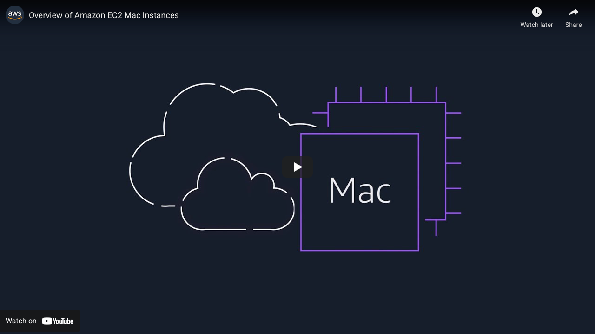
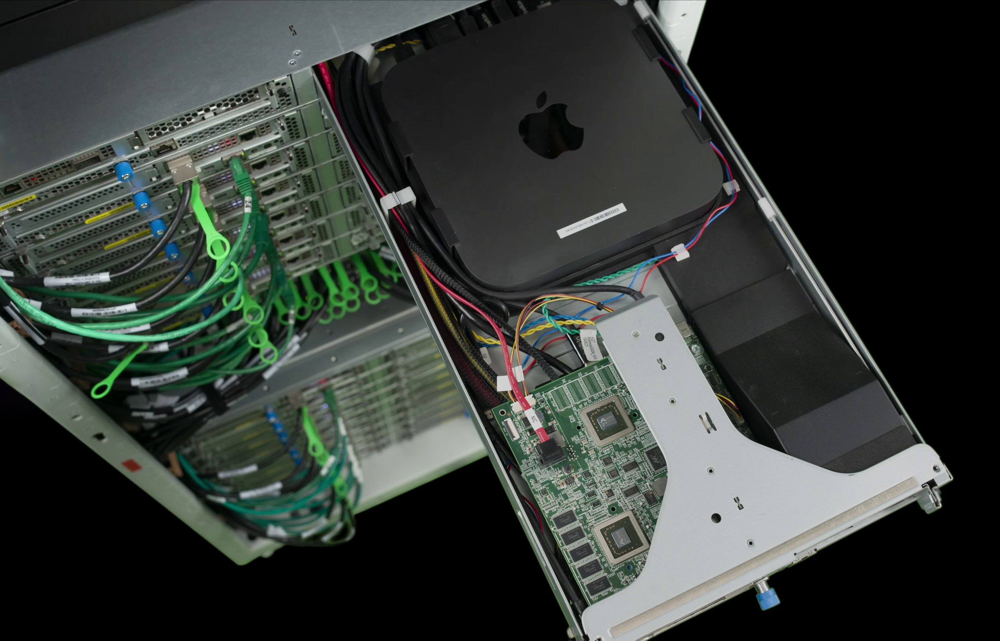

# Amazon EC2 Mac Instances

## ** Welcome! **

* We're happy you're here! *

This repository should help you get up-and-running with Amazon EC2 Mac Instances. See anything missing? Please let us know by [opening a GitHub issue](https://github.com/aws-samples/amazon-ec2-mac-getting-started/issues/new/choose), creating a [re:Post](https://repost.aws/) with the tag #ec2mac, or reaching out via [email](mailto:ec2-mac-wwso@amazon.com), or, if you have something to add, please [open a PR](https://github.com/aws-samples/amazon-ec2-mac-getting-started/compare). Thanks—now, let's get going!

---
### ** What are EC2 Mac Instances? **
---

[Amazon EC2 Mac Instances](https://aws.amazon.com/mac) enable you to run on-demand macOS workloads in the cloud, extending the flexibility, scalability, and cost benefits of AWS to all Apple developers. With EC2 Mac instances, developers creating apps for iPhone, iPad, Mac, Vision Pro, Apple Watch, Apple TV, and Safari can provision and access macOS environments within minutes, dynamically scale capacity as needed, and benefit from AWS's pay-as-you-go pricing.

EC2 Mac instances are built on Apple Mac mini and Mac Studio computers, and are powered by the [AWS Nitro System](https://aws.amazon.com/ec2/nitro/). They offer a choice of Intel x86 or Apple Silicon hardware, enabling support for x86 and Arm64 macOS environments on *macOS Mojave (10.14) (x86 only), macOS Catalina (10.15) (x86 only), macOS Big Sur (11), macOS Monterey (12), macOS Ventura (13), macOS Sonoma (14), macOS Sequoia (15), and macOS Tahoe (26)* as Amazon Machine Images (AMIs).

> **Note:** M4 and M4 Pro Mac instances require macOS Sequoia version 15.6 or later. M2 and M2 Pro Mac instances require macOS Ventura version 13.2 or later.

#### Supported Instance Types

| Instance Type | Chip | Hardware | CPU Cores | GPU Cores | Memory | Neural Engine | Instance Store |
|---|---|---|---|---|---|---|---|
| `mac1.metal` | Intel Core i7 (8th gen) | 2018 Mac mini | 6 physical / 12 logical | — | 32 GiB | — | — |
| `mac2.metal` | Apple M1 | 2020 Mac mini | 8 | 8 | 16 GiB | 16-core | — |
| `mac2-m1ultra.metal` | Apple M1 Ultra | 2022 Mac Studio | 20 | 64 | 128 GiB | 32-core | — |
| `mac2-m2.metal` | Apple M2 | 2023 Mac mini | 8 | 10 | 24 GiB | 16-core | — |
| `mac2-m2pro.metal` | Apple M2 Pro | 2023 Mac mini | 12 | 19 | 32 GiB | 16-core | — |
| `mac-m4.metal` | Apple M4 | 2024 Mac mini | 10 | 10 | 24 GiB | 16-core | 2 TB |
| `mac-m4pro.metal` | Apple M4 Pro | 2024 Mac mini | 14 | 20 | 48 GiB | 16-core | 2 TB |
| `mac-m4max.metal` | Apple M4 Max | Mac Studio | 16 | 40 | 128 GB | 16-core | — |
| `mac-m3ultra.metal` | Apple M3 Ultra | Mac Studio | 28 | 60 | 256 GB | 32-core | — |

> EC2 M4 and M4 Pro Mac instances include a **2 TB instance store volume** per EC2 Mac Dedicated Host, providing low-latency storage for improved caching and build/test performance.

All EC2 Mac instances provide up to 10 Gbps of Amazon VPC network bandwidth and 8 Gbps of Amazon EBS storage bandwidth.

For the latest regional availability of EC2 Mac instance types, see [Amazon EC2 instance types by Region](https://docs.aws.amazon.com/ec2/latest/instancetypes/ec2-instance-regions.html).

Much of the work behind EC2 Mac instances ensures they behave like any other EC2 instance, while still adhering to the [macOS Software License Agreement](https://www.apple.com/legal/sla/). Please note that this SLA applies to any company using macOS—it's not unique to AWS or Amazon!

#### Important Notes

- **Apple Intelligence** is not available on EC2 Mac instances (instances boot from external EBS volumes).
- **Do not enable FileVault** — it will prevent the host from booting. Use [Amazon EBS encryption](https://docs.aws.amazon.com/ebs/latest/userguide/ebs-encryption.html) instead.
- EC2 Mac instances support [Auto Scaling](https://aws.amazon.com/blogs/compute/implementing-autoscaling-for-ec2-mac-instances/).
- Amazon EC2 Mac Dedicated Hosts support [Dedicated Host auto recovery](https://docs.aws.amazon.com/AWSEC2/latest/UserGuide/dedicated-hosts-recovery.html) and [reboot-based host maintenance](https://docs.aws.amazon.com/AWSEC2/latest/UserGuide/dedicated-hosts-maintenance.html).
- macOS Sequoia (15) introduces a Local Network Privacy feature. Users must [approve Local Network Privacy policies via the GUI](https://docs.aws.amazon.com/AWSEC2/latest/UserGuide/macos-ami-overview.html) to maintain access to IMDS and other local IP-based services.

---
### ** Getting Started with Amazon EC2 Mac Instances **
---

#### ** ⇢ Start [here](ec2-macos.md) to get up and running with EC2 Mac! **

---
### ** Ready to go a bit deeper? Take a read! **
---

* Check out our [Collateral page](collateral.md) with blogs, videos, tutorials, and documentation! Topics range from integrations with CI/CD workflows, working with third-party AMIs, deeper dives into how EC2 Mac works, and more. Take a look!

* The [Games](games.md) page has resources on how EC2 Mac enables faster game delivery to market.

* EC2 Mac provides [SNS notifications](https://docs.aws.amazon.com/AWSEC2/latest/UserGuide/ec2-mac-instances.html#subscribe-notifications) for macOS and bridgeOS/firmware updates

* Our [proof-of-concept (PoC) guide](https://github.com/aws-samples/amazon-ec2-mac-getting-started/blob/main/poc.md) walks you through some best practices and guides you step-by-step towards implementation.

* More to come soon!

---
### ** Additional questions? **
---

Please review the [FAQ](faq.md) - and if your question isn't answered there, please open an [issue](https://github.com/aws-samples/amazon-ec2-mac-getting-started/issues/new/choose).

---
_This documentation is made available under the Creative Commons Attribution-ShareAlike 4.0 International License. See the [LICENSE](LICENSE) file. The sample code within this documentation is made available under the MIT-0 license. See the [LICENSE-SAMPLECODE](LICENSE-SAMPLECODE) file._
